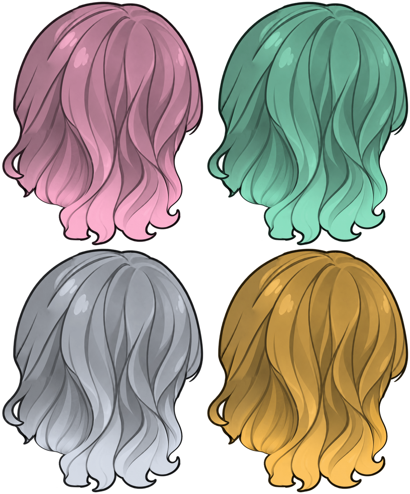

# 06 · 发色自定义

## 效果（真实素材实测，非示意图）



> 左上 樱花粉 `sakura`、右上 薄荷绿 `mint`、左下 银白 `silver`、右下 蜜糖金 `amber`。
> 全部由 `tools/recolor.py` 在原图 `originals/tex/hair_back.png` 上跑出来的，
> 与设备上 `PDHairTint.m` 是同一套公式：**描边、层次、高光都在**。

头发（`hair_back` / `hair_front_*` / `sidelocks` / `bangs` / `ahoge` / `tail` / `ponytail` 等）
贴图做 **HSV 重着色**：保留明暗层次、保留线稿、保留高光，只换色相与饱和度。

实测（`tools/recolor.py`，与 ObjC 同一套算法）：

```
原图 hair_back.png  →  --preset sakura  →  粉色长发，黑色描边与白色高光完整保留
```

## 三种入口，同一组偏好键

### 1) 设置 App →「发色」

`Root.plist` 里新增的分页（纯 specifier，不用编偏好包）：

| cell | key | 说明 |
|---|---|---|
| 开关 | `HairTint` | 总开关 |
| 列表 | `HairTintMode` | `preset` 预设 / `custom` 自定 / `rainbow` 彩虹 |
| 列表 | `HairTintPreset` | 10 个预设（樱花粉/薄荷绿/天空蓝/薰衣草/蜜糖金/烈焰红/银白/墨黑/抹茶/蜜桃） |
| 滑杆 | `HairHue` | 0–360 |
| 滑杆 | `HairSat` | 0–100（百分比，55 ≈ 中等饱和） |
| 滑杆 | `HairValue` | 40–160（明度乘子，100 = 不变） |
| 滑杆 | `HairTintStrength` | 0–100（与原始像素的混合强度） |
| 滑杆 | `HairTintSpeed` | 0–100（彩虹流动速度） |
| 开关 | `HairTintSmooth` | 保护近黑线稿与纯白高光（默认开） |
| 开关 | `HairTintIncludeBrows` | 连眉毛一起染（默认关） |

### 2) 长按宠物 →「发色」面板

`PDHairTintPanel`：色板（10 个圆点）+ 4 条滑杆 + 模式切换 + 应用/关闭。
拖动即生效（写偏好 → `PDHairTint reload` → 发通知 → 渲染器重建贴图）。

打开方式：
* `PDLayout.json` 里把某个手势映射成 `"hair"`（推荐，见 `docs/05`）
* 或 `performCommand:@"hair"`
* 悬浮按钮列表里加 `"hair"`：`defaults write com.susudear.petdfyprefs HoverButtons -array chat voice hair`

### 3) 命令行

```bash
ssh root@手机IP '
D=com.susudear.petdfyprefs
defaults write $D HairTint -bool YES
defaults write $D HairTintMode -string custom
defaults write $D HairHue -float 200
defaults write $D HairSat -float 70
defaults write $D HairValue -float 110
defaults write $D HairTintStrength -float 100
killall -9 SpringBoard'
```

## 单部件覆盖

想让"下半截银白、上面还是粉的"这类效果，写 `HairTintParts`：

```bash
defaults write com.susudear.petdfyprefs HairTintParts \
  '{ "hair_back" = "#D8DEE9"; "tail" = "#8FC7FF"; }'
```

键 = 部件 id（不是贴图文件名），值 = `#RRGGBB`。

## 算法（就这三行，改起来没黑箱）

对每个像素（`PDHairTint -newTintedImage:...`）：

```
h' = 目标色相
s' = S目标 × (0.45 + 0.85 × s原)      // 保留发丝之间的饱和度差异
v' = v原 × V乘子                       // 保留明暗
out = orig + (hsv(h',s',v') - orig) × strength
跳过：v < 0.10 且 s < 0.35（线稿）   v > 0.985 且 s < 0.04（高光）
```

要"只染刘海""按渐变染""按深度染"，改这个函数即可，签名不变：

```objc
- (CGImageRef)newTintedImage:(CGImageRef)src part:(NSString *)part color:(UIColor *)color;
```

## 为什么不动 Metal 着色器

`Whale.metal` 里其实有 tint 通道：

```metal
c.rgb = mix(c.rgb, c.rgb * look.tint.rgb, look.tint.a);
```

但走它需要给每个 mesh 提交 `Appearance` uniform（80 字节结构体），
而当前还原版的 `drawMesh:` 只提交了管线/纹理/顶点——补 uniform 会牵动管线与剪裁逻辑。
贴图级重着色有三个好处：

1. **命中蒙版不受影响**：`WNHitMask` 由 alpha 派生，我们只改 RGB
2. **线和阴影照旧**：`blend: multiply` 的 `skirt_shadow` 等不受牵连
3. **换衣服/换主题不丢色**：`resetLiveWithScheme:` 后重新注入即可

注入点是官方既有机制：`texture:` 先查 `liveTextures`。
发色引擎把重着色后的 `MTLTexture` 以**部件贴图名**为键塞进去，渲染路径完全不变。

## 电脑上先看效果（不用刷机）

```bash
# 单张
python3 tools/recolor.py \
  -i assets_src/originals/tex/hair_back.png \
  -o /tmp/pink.png --preset sakura

# 10 个预设并排对照（输出 4550×548 长图）
python3 tools/recolor.py --palette assets_src/originals/tex/bangs.png \
  --palette-out /tmp/palette.png

# 自定义 HSV
python3 tools/recolor.py -i assets_src/originals/tex/bangs.png -o /tmp/x.png \
  --hue 200 --sat 70 --value 110 --strength 100
```

## 性能

* 静态色：只在换装/改配置时重着色一次（约 8 张图，各几百 KB 像素循环），可忽略
* 彩虹：`HairTintSpeed` 决定色相推进速度，贴图按 **1/8 秒**节流重建
  （`PDHairTint needsRefreshAtTime:` 里的 `_refreshInterval`）
  老设备觉得热就调小速度，或把 `_refreshInterval` 改成 `1.0/6.0`

## 排错

| 现象 | 原因 |
|---|---|
| 开了但没变色 | 部件名没被识别成头发 → 用 `tools/recolor.py` 确认该贴图有效；或部件 id 不在 `defaultHairParts` 且名字里没有 `hair` |
| 线稿也变色了 | 关掉 `HairTintSmooth` 的反面：**保持开启**；仍未解决说明该贴图线稿不够黑（v>0.10） |
| 变成一整块纯色 | `HairTintStrength` 太高 + 原贴图饱和度过低（是灰阶图）→ 降到 60–80 |
| 换装后掉色 | 不应发生；若发生检查 `WNRenderer+HairTint` 的 `pdApplyHairTintForParts:` 是否确实被 `resetLiveWithScheme:` 调到 |
